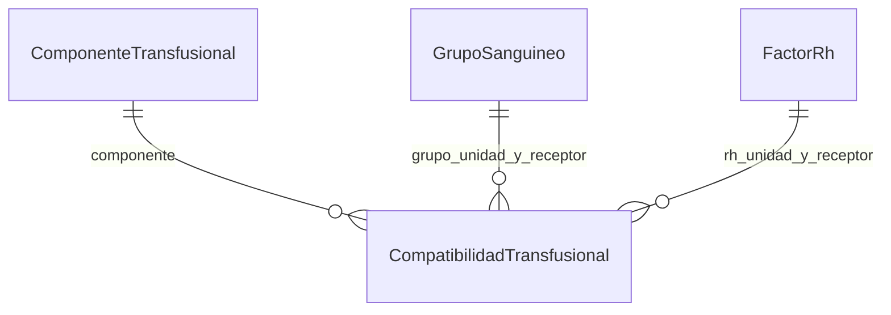

# Compatibilidad configurable

Las combinaciones permitidas del filtro PN2 se administran desde **Maestros → Compatibilidades**. El componente, el grupo y el factor Rh son códigos de sus respectivos maestros. No hay listas de esos valores dentro del filtro en ejecución.

## Cómo usar la pantalla

1. Creá las opciones nuevas en **Componentes**, **Grupos sanguíneos** y **Factor Rh**, si todavía no existen.
2. Entrá en **Compatibilidades**. La pestaña vuelve a cargar las opciones al abrirse; también podés usar **Actualizar**.
3. Elegí **Nuevo**, el componente, el grupo/Rh de la unidad y el grupo/Rh del receptor.
4. Marcá **Activo** y guardá. La regla se aplica en la siguiente consulta, reserva o entrega.
5. Para deshabilitarla, seleccioná su fila y elegí **Dar de baja**. Para rehabilitarla, marcá **Activo** y guardá.

El filtro de texto permite buscar por componente o por combinaciones como `O-`. Se muestran tanto reglas activas como inactivas. Al seleccionar una regla existente, su combinación queda fija; para cambiarla, desactivá la anterior y creá otra. Los duplicados se rechazan incluso si la regla anterior está inactiva: se debe reactivar la fila existente.

Se requiere el permiso **MAESTROS_PN1_ADMINISTRAR** en Application y SQL. Para activar una regla, sus cinco valores deben existir y estar activos en los maestros. Una regla que utiliza opciones dadas de baja puede desactivarse igualmente. Las reglas ya existentes siguen describiendo el historial aunque se den de baja opciones del catálogo.

## Cómo leer la tabla

Cada fila de `CompatibilidadTransfusional` describe **una dirección permitida**:

| Campo | Significado |
| --- | --- |
| `id_compatibilidad` | Identificador de la regla. |
| `tipo_componente` | Código del componente de la unidad y del pedido. |
| `grupo_unidad`, `rh_unidad` | Tipificación de la unidad disponible. |
| `grupo_receptor`, `rh_receptor` | Tipificación registrada para el receptor. |
| `activo` | Habilita o deshabilita la combinación. |

Por ejemplo, la fila `Concentrado de eritrocitos / O / - / A / + / 1` permite que esa unidad aparezca como candidata para ese receptor. No habilita automáticamente la dirección inversa ni otros componentes o valores de Rh. Un `+` y un `-` son dos valores distintos; si ambos se admiten, se cargan dos filas. No hay comodines ni valores vacíos.



Hay cinco claves foráneas: componente y dos relaciones con cada uno de los catálogos de grupo y Rh. Una restricción única impide repetir la combinación completa.

## Flujo PN2

`Unidad + datos del receptor → buscar combinación activa → aplicar los demás controles → mostrar candidata`

`fn_PN2_GrupoCandidato` consulta la tabla y devuelve `1` únicamente cuando encuentra una fila activa. Sin regla, con una regla inactiva o con datos incompletos devuelve `0`. Se usa la misma función al buscar candidatas, reservar y entregar. La unidad también debe cumplir el estado, vencimiento, disponibilidad y componente de la solicitud; el estudio debe estar validado y la reserva requiere la referencia de confirmación del personal.

Desactivar una regla después de reservar impide entregar por esa combinación mientras siga desactivada. No modifica entregas anteriores ni cancela automáticamente reservas. La tabla configura el filtro preliminar del software; la comprobación final del personal continúa siendo necesaria.

## Carga inicial e instalación

`Database/StoredProcedures/06a_CompatibilidadTransfusional.sql` crea y precarga la tabla una sola vez. Convierte las reglas anteriores para los componentes reconocidos que ya existen en el catálogo:

- Eritrocitos: la matriz ABO anterior y sus combinaciones de Rh.
- Plasma: la matriz ABO anterior, con todas las combinaciones de Rh.
- Plaquetas: el mismo grupo y las combinaciones de Rh que admitía el filtro anterior.

Con los tres componentes originales son **75 filas**: 27 de eritrocitos, 36 de plasma y 12 de plaquetas. Los nombres alternativos reconocidos por la versión anterior también se migran si ya están presentes en el catálogo. Un componente agregado posteriormente, aunque su nombre fuera conocido antes, necesita sus reglas explícitas.

Para una base nueva, los instaladores incluyen `06a` después de `06_MaestrosPN1.sql` y antes de PN2. Para una base existente, con la aplicación cerrada, ejecutá desde la raíz:

```powershell
./Database/InstalarCompatibilidad.ps1
```

Este instalador requiere PN2 y Maestros instalados, verifica un respaldo y aplica la matriz y las tres definiciones del filtro en una transacción. No vuelve a ejecutar las demás migraciones. Para una instalación PN1 sin PN2, `InstalarMaestrosPN1.ps1` también incluye la matriz. Repetirlo conserva las reglas personalizadas y las bajas: no vuelve a cargar los valores iniciales. Volvé a abrir la aplicación al terminar.

Los cambios se guardan en `Auditoria`, entidad `CompatibilidadTransfusional`, con valores anteriores, nuevos y usuario. `CompatibilidadTransfusionalControl` conserva una huella de las reglas y su historial. Una alteración externa bloquea las consultas de reglas, la búsqueda de candidatas y las operaciones de PN2; reinstalar no acepta esa alteración. Recuperar desde una copia confiable, como con los demás maestros. No editar directamente las filas ni recalcular manualmente su huella.

## Validación

```powershell
MSBuild Tests/CompatibilidadUI.Tests.csproj /restore
./Tests/Compatibilidad.Configurable.Tests.ps1
```

La prueba crea y elimina una base temporal. Compara las 192 combinaciones originales, prueba códigos nuevos de los tres maestros, permisos, duplicados, bajas, reactivación, reinstalación, auditoría, alteraciones y el flujo completo de búsqueda, reserva y entrega. También verifica la pestaña y sus traducciones en español e inglés. No modifica `DAL/App.local.config`.

La vista temporal XML admite códigos de grupo/Rh de hasta cinco caracteres, para que los valores nuevos puedan exportarse y deserializarse. Como antes, importar XML no consulta ni modifica la base y no habilita operaciones sobre esas filas.
